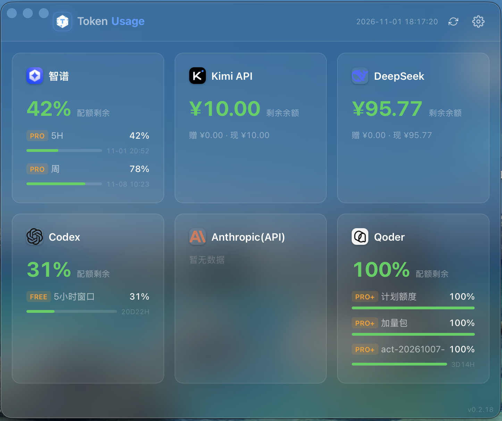
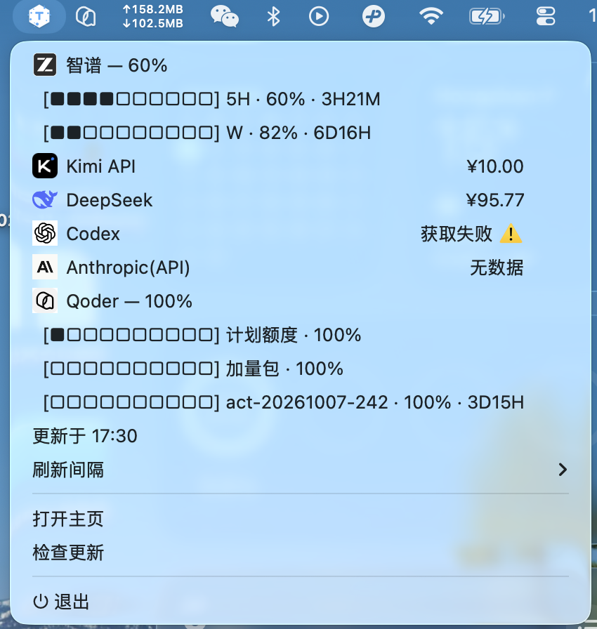

# LLM Token Usage Monitor Desktop

一款轻量级桌面应用，用于监控多个本地 LLM 服务商的 Token 用量与余额。基于 Tauri、React、TypeScript 和 Rust 构建。


## 功能预览

| 主面板 | 托盘菜单 |
|:------:|:--------:|
|  |  |

## 功能特性

- **多服务商支持** — 同时监控多个 LLM 平台的使用情况：
  - DeepSeek / Kimi API（月之暗面）/ 智谱（GLM）
  - OpenAI / Anthropic（需组织管理员密钥）
  - Codex / Claude Code / Kimi Code（自动读取本机 CLI 凭证）
  - Qoder（自动读取本机客户端凭据，macOS；其他平台可填个人访问令牌 PAT）
- **实时用量追踪** — 一目了然地查看 Token 消耗、余额与多配额桶剩余百分比
- **低余额通知** — 余额或配额告警恶化时弹出系统通知，可在设置页开关并用测试通知自证链路
- **系统集成托盘** — 在后台安静运行，原生支持系统托盘图标，菜单指标数值右对齐（macOS）
- **开机自启** — 可选随系统启动自动运行
- **定时轮询** — 按可配置的时间间隔自动刷新用量数据（托盘菜单可选档位）
- **应用内自动更新** — 自动检查新版本，可在应用内直接下载安装并重启
- **低资源占用** — 基于 Tauri 轻量级 Rust 后端驱动

## 下载安装

前往 [GitHub Releases](https://github.com/hajifish/LLM-Token-Usage-Monitor-Desktop/releases) 下载最新版本。

| 平台 | 芯片 | 文件格式 |
|------|------|----------|
| macOS | Apple Silicon (M1/M2/M3/M4) | `.dmg` |
| Windows | x64 | `.exe`（NSIS 安装包，推荐） |
| Windows | x64 | `.msi`（可选，需手动升级，不支持应用内自动更新） |

> 暂不支持 Intel 芯片的 Mac。如需 Intel 版本，请自行从源码构建。

> Windows 用户建议使用 `.exe`（NSIS）安装包：它按用户安装、不需要管理员权限，且是应用内自动更新使用的格式。若你此前安装的是 `.msi` 版本，建议卸载后改用 `.exe` 重新安装，以便获得自动更新能力（卸载不会删除 `%APPDATA%` 下的配置，密钥无需重新录入）。

### macOS 首次打开提示「已损坏」

由于应用未经 Apple 签名和公证，macOS 会阻止运行。打开终端执行以下命令即可解除限制：

```bash
xattr -dr com.apple.quarantine /Applications/Token\ Usage.app
```

> 如果应用不在 `/Applications` 目录，请替换为实际路径。

## 应用内自动更新

自 v0.2 起，应用内置自动更新能力：

- **检查时机** — 启动 60 秒后检查一次，之后每小时检查一次；也可在托盘菜单点击「检查更新」，或主窗口顶部的更新横幅中手动检查。
- **检查对象** — GitHub Releases 上已发布的**最新正式版本**（草稿版本对外不可见，因此发布草稿即更新闸门）。已是最新版本时不会打扰你。
- **下载与安装** — 发现新版本后可在应用内直接下载、安装并自动重启，无需再手动下载安装包。
- **签名校验** — 更新包使用 minisign 签名，公钥内置于应用；校验不通过会放弃本次更新。
- **macOS 权限提示** — 替换 `/Applications` 下的应用需要管理员权限，安装时可能弹出系统密码框，属于正常现象。
- **首次获取该能力** — v0.2 之前的版本不含更新模块，需要手动安装一次 v0.2 或更高版本；此后即可在应用内自动更新。

## 配置文件与密钥安全

本应用会将各服务商的 API 密钥等配置保存在本地配置文件中。自本版本起，该配置文件由明文 JSON 升级为**机器绑定加密信封**，请在使用前了解以下几点。

### 配置文件路径

| 平台 | 路径 |
|------|------|
| macOS | `~/Library/Application Support/com.hajifish.llm-token-monitor/config.json` |
| Windows | `%APPDATA%/com.hajifish.llm-token-monitor/config.json` |
| Linux | `~/.local/share/com.hajifish.llm-token-monitor/config.json` |

### 文件不再是可直接编辑的明文

配置文件现在使用 XChaCha20-Poly1305 加密，密钥由「本机硬件标识 + 应用内置派生上下文」经 BLAKE3 派生得到，**解密密钥不会写入磁盘**。因此：

- **请勿再手工编辑该文件**——文件内容为密文，直接用文本编辑器修改不仅无效，还可能导致无法解密。
- 所有密钥的录入与修改请通过应用内的**设置页**完成（设置页仍以明文回显密钥，交互方式未变）。
- 首次启动本版本时，应用会自动将存量明文配置迁移为加密格式：迁移采用「临时文件 + 原子替换」并回读校验，迁移失败时会保留原文件不动、下次启动重试；迁移成功后文件权限收紧为仅当前用户可读写（Unix 下为 `0600`）。

### 换机、重装系统或系统标识变化

加密密钥与本机硬件标识绑定。一旦发生**更换电脑、重装系统、或系统标识发生变化**，原有密文将无法解密。此时：

- 应用**不会静默覆盖**原文件，而是将其自动备份为 `config.json.unreadable-<时间戳>.bak`，随后允许你重新录入密钥。
- 前端会显示提示横幅，告知配置文件无法读取、需要重新填写。

### 版本回退警告

> **重要：** 如果你回退到本次升级之前的旧版本，旧版本无法读取加密后的配置文件；在旧版本中执行保存操作会以明文覆盖该文件，导致已保存的加密密钥丢失。如确需回退到旧版本，请先在设置页记录或导出你的密钥。

### 威胁模型（它能防什么、不能防什么）

我们不夸大安全承诺。本方案的定位是**显著提高配置文件脱离本机后离线泄露的破解成本**，而非绝对安全：

- **能够防御**：配置文件副本脱离本机后被动泄露的场景，例如被云同步、系统备份、误当作附件发送等。
- **不能防御**：已经登录同一台机器、同一用户账户的攻击者。此类攻击者可以读取本机硬件标识，并从公开的源码中取得派生参数，从而在离线状态下重新计算出解密密钥；本方案也**不防御运行期的进程内存读取**。

简言之，本方案把明文密钥的暴露面从「任何拿到这个文件的人」收窄到「能在这台机器上以你的身份执行代码的人」。

### 日志位置（用于报障）

应用日志由 tauri-plugin-log 写入系统日志目录：

| 平台 | 路径 |
|------|------|
| macOS | `~/Library/Logs/com.hajifish.llm-token-monitor/` |
| Windows | `%APPDATA%/com.hajifish.llm-token-monitor/logs/` |
| Linux | `~/.local/share/com.hajifish.llm-token-monitor/logs/` |

> 日志中不包含任何密钥内容，可在报障时放心附上。

## 技术栈

| 层级   | 技术方案                  |
|--------|---------------------------|
| 前端   | React 18 + TypeScript     |
| 后端   | Rust（Tauri 2）           |
| 构建   | Vite 6                    |
| 框架   | Tauri 2                   |

## 开发

### 环境准备

- [Node.js](https://nodejs.org/) v18+
- [Rust](https://www.rust-lang.org/tools/install) stable 工具链
- [Tauri 系统依赖](https://v2.tauri.app/start/prerequisites/)

### 快速开始

```bash
# 1. 克隆仓库
git clone https://github.com/hajifish/LLM-Token-Usage-Monitor-Desktop.git
cd LLM-Token-Usage-Monitor-Desktop

# 2. 安装前端依赖
npm install

# 3. 以开发模式运行（支持热重载）
npm run tauri dev
```

### 构建生产版本

```bash
npm run tauri build
```

构建产物位于 `src-tauri/target/release/bundle/` 目录。

> **注意：** 项目开启了 `bundle.createUpdaterArtifacts`，生成更新包需要 minisign 私钥，因此本地直接执行 `npm run tauri build` 会因缺少密钥而失败。仅做本地构建校验时，可用下面的命令临时关闭更新包生成：
>
> ```bash
> npm run tauri build -- --config '{"bundle":{"createUpdaterArtifacts":false}}'
> ```
>
> 需要完整复现发版构建时，请设置 `TAURI_SIGNING_PRIVATE_KEY`（私钥内容，或指向密钥文件的路径）及其口令 `TAURI_SIGNING_PRIVATE_KEY_PASSWORD`。私钥属于敏感信息，不要提交到仓库。

### 版本号与发版机制

- 版本号 = 发布 tag，格式 `vX.Y.Z`。release.yml 构建时取 `${tag#v}` 写入 5 处清单；号段由人工决定，全局只升不降（应用内更新按 semver 比较）。
- 发版流程：develop → master 合并 → 手动 `git tag vX.Y.Z && git push origin vX.Y.Z` → tag push 自动触发 release.yml → 等草稿 Release 构建完成 → 手动 publish。publish 后 `releases/latest/download/latest.json` 才对外可见，发布草稿即更新分发闸门。
- 仓库内静态版本号（package.json / package-lock.json / Cargo.toml / Cargo.lock / tauri.conf.json）**仅为本地开发构建展示用**，不随发布手工对齐；CI 有版本一致性守卫，要求这 5 处互相一致（仅要求内部自洽，不要求与最新发布一致），不一致时构建直接失败。

### 贡献指南

欢迎提交 Issue 和 Pull Request。详见 [CONTRIBUTING.md](CONTRIBUTING.md)。

## 项目结构

```
├── src/                        # React 前端
│   ├── components/
│   │   ├── ErrorBoundary.tsx   # 错误边界组件
│   │   ├── Settings.tsx        # 服务商配置页面
│   │   ├── UpdateNotice.tsx    # 应用内更新提示与进度
│   │   └── UsagePanel.tsx      # 用量展示面板
│   ├── hooks/
│   │   ├── useUpdate.ts        # 更新状态 Hook
│   │   └── useUsage.ts         # 数据获取 Hook
│   ├── styles/
│   │   └── app.css             # 全局样式（浅色主题）
│   └── App.tsx                 # 主应用组件
├── src-tauri/                  # Rust 后端
│   ├── src/
│   │   ├── providers/          # LLM 服务商接口
│   │   │   ├── deepseek.rs     # DeepSeek
│   │   │   ├── kimi.rs         # Kimi（月之暗面）
│   │   │   ├── zhipu.rs        # 智谱（GLM）
│   │   │   ├── openai.rs       # OpenAI
│   │   │   ├── anthropic.rs    # Anthropic
│   │   │   ├── codex.rs        # Codex（ChatGPT，CLI 凭证）
│   │   │   ├── claude_code.rs  # Claude Code（CLI 凭证）
│   │   │   ├── kimi_code.rs    # Kimi Code（CLI 凭证）
│   │   │   └── qoder.rs        # Qoder（本机客户端凭据 / PAT）
│   │   ├── commands.rs         # Tauri 命令处理器
│   │   ├── config.rs           # 配置管理
│   │   ├── menu_align.rs       # 托盘菜单数值右对齐（macOS）
│   │   ├── models.rs           # 数据模型
│   │   ├── notification.rs     # 低余额系统通知
│   │   ├── scheduler.rs        # 后台轮询调度器
│   │   ├── secrets.rs          # 配置加密信封（XChaCha20-Poly1305）
│   │   ├── tray.rs             # 系统托盘
│   │   └── updater.rs          # 应用内自动更新
│   └── Cargo.toml
└── .github/workflows/          # CI/CD
    ├── build.yml               # 构建验证
    └── release.yml             # 发布工作流
```

## 许可证

本项目基于 MIT 许可证开源，详情请参阅 [LICENSE](LICENSE) 文件。
